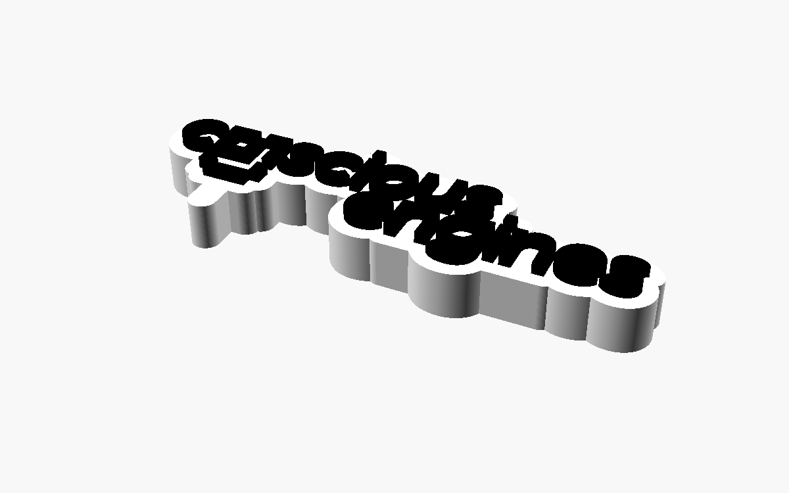

# nameplates

Generate 3D-printable, multi-color desk nameplates from an SVG logo. The output
is a Bambu/Orca-ready 3MF where the base prints in white and the raised text
prints in black, auto-assigned to the correct filaments on import.



## Requirements

- **OpenSCAD 2024+** at `/Applications/OpenSCAD.app/Contents/MacOS/OpenSCAD`
  (older builds don't ship `--enable=lazy-union`).
- **uv** for Python (`brew install uv` on macOS).

## Quick start

```bash
git clone git@github.com:apoorvumang/everything3d.git
cd everything3d/nameplates
uv sync                       # install Python deps
uv run scripts/build_3mf.py   # render + post-process to a multi-color 3MF
```

Open `exports/nameplate.3mf` in Bambu Studio (`File → Import → Import 3MF...`).
Each part comes pre-assigned to its filament. Convention: filament 1 = first
`color()` block in the SCAD (white in this project), filament 2 = second
(black).

## Swapping in a new SVG

1. Drop the SVG into `svgs/`.
2. Find the bounds: `uv run scripts/svg_bounds.py svgs/yours.svg`.
3. Update the metric constants near the top of
   [`nameplate-offset.scad`](nameplate-offset.scad):
   - `svg_native_width` / `svg_native_height` — viewBox or content bbox.
   - `svg_baseline_y` — y of the row baseline (top=0, y grows down in SVG).
   - `svg_descender_bottom_y` — y of the lowest visible point (bottom of
     `g`/`p`/`q`/`y`).
4. Position the support leg with `leg_x_center_svg` (in SVG units). The leg
   drops to the descender level so the plate sits flat when stood up.
5. `uv run scripts/build_3mf.py`.

## Podium nameplate

A flat rectangular nameplate with rounded corners and raised text — designed for
podium/desk use.

- `podium_nameplate_itc.scad` — full nameplate with name + taglines
- `base_plate.scad` — just the base plate (109 × 49 × 1 mm, 2.5 mm corner radius)
- `base_plate.stl` — exported STL of the base plate

## File layout

```
nameplate-offset.scad      OpenSCAD source (SVG-based nameplate)
podium_nameplate_itc.scad  Podium nameplate with text
base_plate.scad            Base plate only (for standalone printing)
base_plate.stl             Exported STL of base plate
scripts/
  svg_bounds.py            Compute path bbox + spot the baseline / descender
  build_3mf.py             Render via OpenSCAD + post-process to multi-color 3MF
  debug_svg_center.scad    Sanity-check SVG → OpenSCAD coord mapping
svgs/                      Source SVGs
exports/                   Generated 3MF
docs/                      Preview images
```

## Why a custom 3MF post-processor?

OpenSCAD's GUI "Export 3MF" merges all top-level statements into one mesh, with
colors recorded as per-triangle `p1` attributes. Bambu Studio (as of writing)
only honors *object*-level color, so the whole thing prints in one filament.

[`scripts/build_3mf.py`](scripts/build_3mf.py) solves this in three steps:

1. Render with `--enable=lazy-union` so each top-level `color()` block becomes
   its own `<object>` in the 3MF (instead of being merged).
2. For each object, set `pindex` to match the dominant `p1` of its triangles.
   Now the object-level color matches the geometry — Bambu's plate preview
   shows the right colors.
3. Write `Metadata/model_settings.config` mapping each object id to an
   `extruder` index. Bambu reads this on import and auto-assigns filaments —
   no manual fix-up required.

Convention: `pindex N → extruder N`, matching the order of `color()` blocks in
the SCAD.
